<a href="https://github.com/saqlain-489">
  <picture>
    <source media="(prefers-color-scheme: dark)" srcset="assets/banner-dark.svg">
    
  </picture>
</a>

For about two years I have been building **Ilmiya**, an EdTech and learning platform, at **Genius Mind Zone**: five backend services, six client apps, and the AI that writes its courses. I work across the stack, from Node.js and TypeScript APIs and their databases to React and Next.js apps, and I like owning a feature from design to deployment.

**Shipped at work**

- **Multi-agent course generation, in production.** Planner, writer and quality-check agents on Mastra and Azure OpenAI produce complete language-course units. Routing simpler work to cheaper models, with fallbacks between models, cut its running cost by about 85%.
- **An evaluation harness for that AI:** deterministic checks, LLM judges calibrated on known-good units, golden datasets, and a CI gate on every change to the agents.
- **Real-time messaging and class discussions:** 21 REST endpoints in Node.js, Express and TypeScript, plus the React interface with live updates over Socket.IO, reply threads, reactions and attachments.
- **The move from Firebase to Better Auth** across four backend services and six apps, migrating existing accounts without locking anyone out.
- **A recitation-scoring service in Python:** Whisper speech recognition plus Arabic text matching, running in Docker on Kubernetes.

### Featured projects

<a href="https://github.com/saqlain-489/quizforge"><picture><source media="(prefers-color-scheme: dark)" srcset="assets/card-quizforge-dark.svg"></picture></a>&nbsp;<a href="https://github.com/saqlain-489/recite"><picture><source media="(prefers-color-scheme: dark)" srcset="assets/card-recite-dark.svg"></picture></a>
<a href="https://github.com/saqlain-489/dialdesk"><picture><source media="(prefers-color-scheme: dark)" srcset="assets/card-dialdesk-dark.svg"></picture></a>&nbsp;<a href="https://github.com/saqlain-489/pk-job-radar"><picture><source media="(prefers-color-scheme: dark)" srcset="assets/card-pk-job-radar-dark.svg"></picture></a>

### Stack

**Every day:** TypeScript, Node.js, Express, React, Next.js, PostgreSQL, MongoDB, Redis, BullMQ, Socket.IO 
**AI:** Mastra multi-agent workflows, Claude and OpenAI APIs, RAG, LLM evaluation, MCP, Whisper 
**Infrastructure:** Docker, Kubernetes, AWS, GitHub Actions, OpenTelemetry, Cloudflare Workers

### Contact

[saqlainahmad489@gmail.com](mailto:saqlainahmad489@gmail.com) · [LinkedIn](https://www.linkedin.com/in/saqlain-ahmad-developer/) · Faisalabad, Pakistan (UTC+5)
