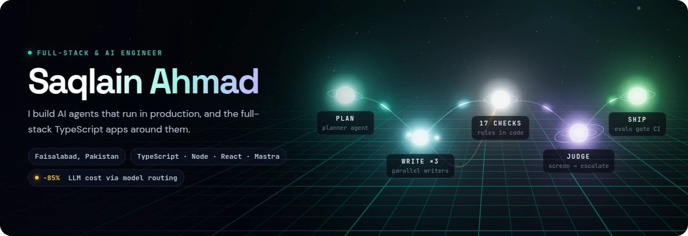
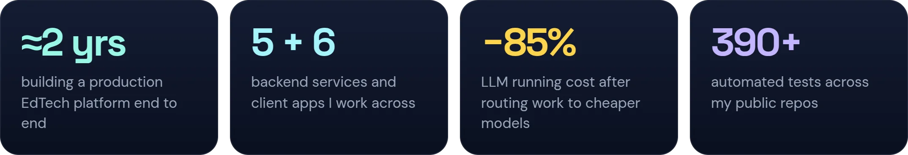
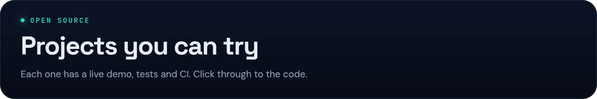
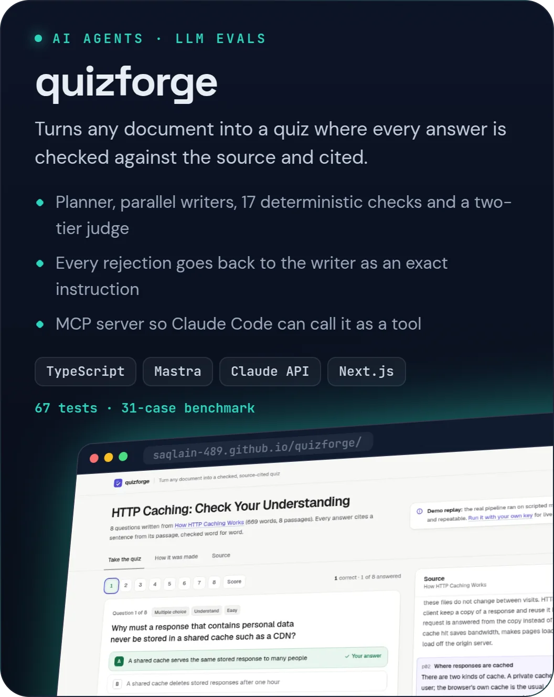
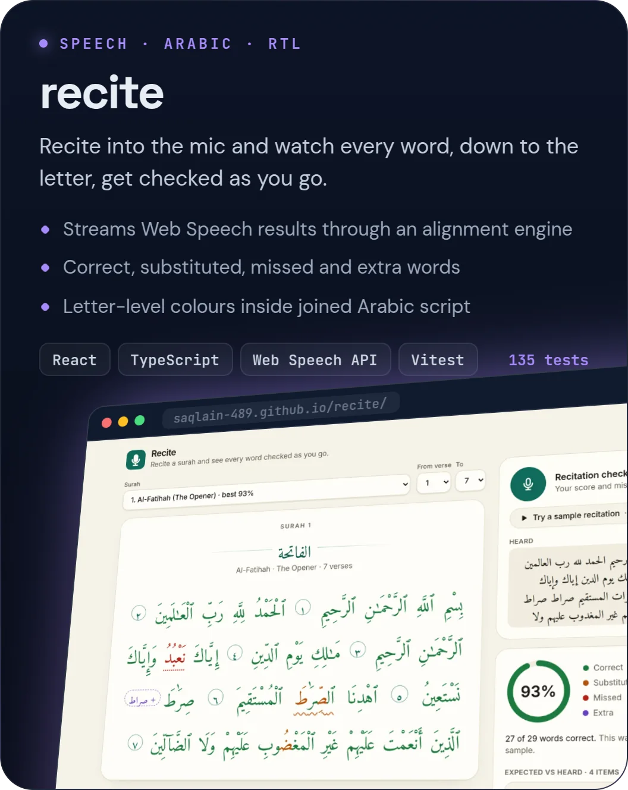
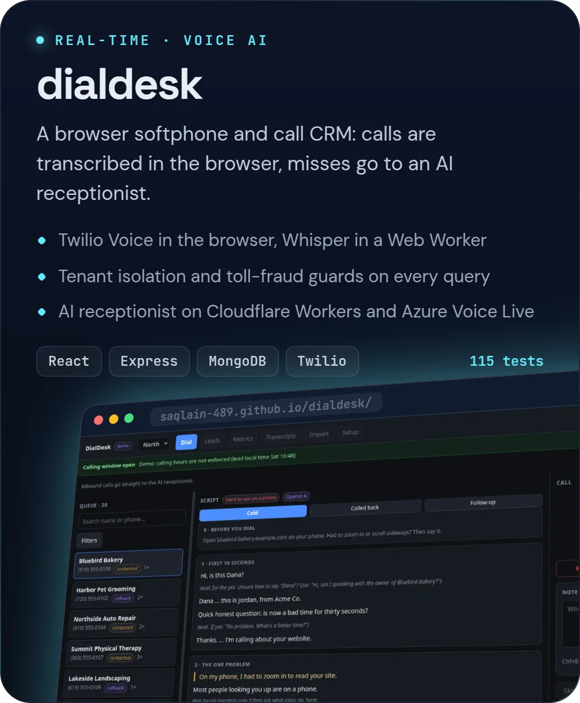
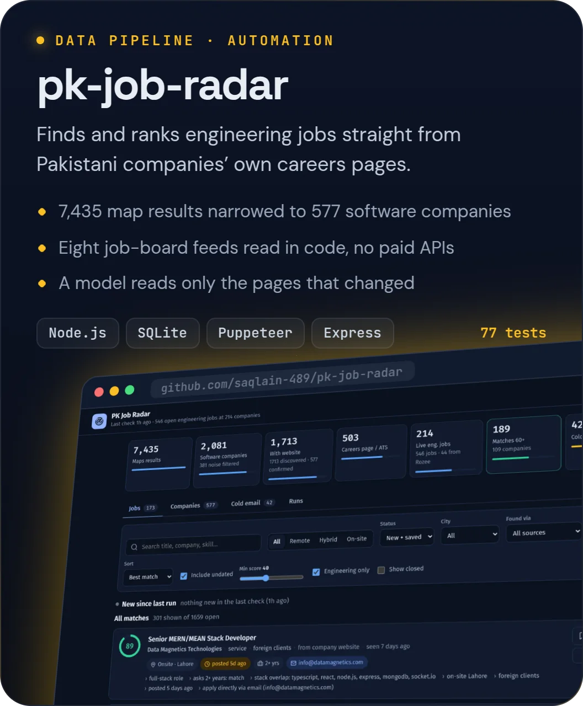
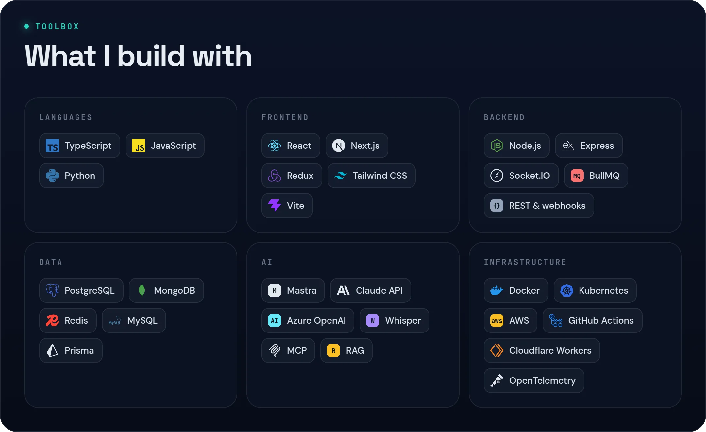

<a href="https://saqlain-489.github.io/">
  <picture>
    <source media="(prefers-reduced-motion: reduce)" srcset="assets/hero-still.webp">
    
  </picture>
</a>

  
  
  

&nbsp;
&nbsp;

<b>Try them live:</b> <a href="https://saqlain-489.github.io/quizforge/">quizforge</a> · <a href="https://saqlain-489.github.io/recite/">recite</a> · <a href="https://saqlain-489.github.io/dialdesk/">dialdesk</a>

Every image on this page, the 3D hero included, is rendered from my portfolio's own code. <a href="https://github.com/saqlain-489/saqlain-489.github.io">See how</a>.

